<div align="center">
  
  <br/>
  
  <br/><br/>
  <a href="https://linkedin.com/in/shyanpaul"></a>
  <a href="https://orcid.org/0009-0004-7465-0871"></a>
  </div>

**AI/ML Engineer in the making. I build machine learning systems that work in production and know their limits.**

Bengaluru-bound. Currently an ML Intern at AdroIT Technologies, Coimbatore.

---

## About

I am a third-year B.Sc. Artificial Intelligence and Machine Learning student at Rathinam Global University, Coimbatore (graduating 2027). My work sits where research methods meet working software: I like taking a model from an idea to something people can actually use, and being honest about how well it works.

At AdroIT I am the first ML intern on the development team. I build and ship retrieval-augmented generation (RAG) services for real products, and I spend as much time on latency, cost, security and testing as on the model itself. Alongside that, I build software for clients as a developer at Niyosoft Technologies.

## What I work on

- **Applied ML and generative AI:** RAG pipelines, LLM integration, sentiment analysis, and the engineering around them: caching, fallbacks, evaluation and API design.
- **Computer vision and scientific ML:** vision transformers, model ensembles, explainability, and astronomy datasets.
- **Reliable ML:** uncertainty quantification and conformal prediction, so a model reports how much to trust each prediction.
- **Quantum machine learning:** hybrid quantum-classical models using Qiskit and PennyLane, including runs on IBM Quantum hardware.
- **Shipping software:** FastAPI backends, Docker, tests and CI, and turning requirements from real users into working products.

## Open source

Merged contribution to [pytorch/examples](https://github.com/pytorch/examples), fixing how the ImageNet example resumes its learning rate.

## Stack

```
ML / DL        PyTorch, scikit-learn, TensorFlow, Hugging Face, PennyLane, Qiskit
GenAI          LlamaIndex, FAISS, sentence-transformers, Gemini API
Vision         OpenCV, MediaPipe, Grad-CAM
Backend        FastAPI, Flask, MySQL, MongoDB, SQLite
Infra          Docker, GitHub Actions, Git
Science        Astropy, SciPy, NASA datasets
```

## Credentials

IBM Certified in Quantum Machine Learning, Machine Learning with Python, and Python for Data Science. Qiskit Advocate.

## Looking for

ML and AI engineering internships and roles at product companies in Bengaluru, especially work involving LLM applications, RAG, or computer vision.

